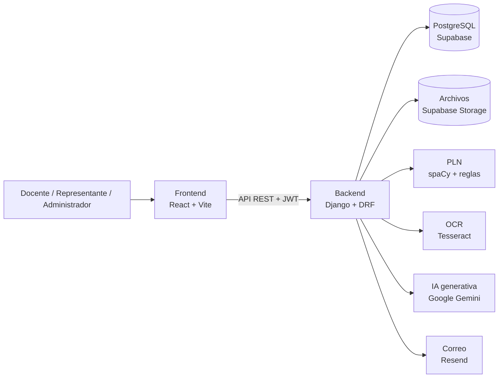

# EduGest

[](https://github.com/MelanieGarciaO/EDUGEST/actions/workflows/ci.yml)


Aplicativo web para la **gestión de actividades académicas y planes de refuerzo** entre docentes y
representantes de estudiantes de **Educación General Básica Media (5.º a 7.º grado)**.

El docente registra actividades y calificaciones; el sistema detecta los temas con dificultad,
analiza los textos con **Procesamiento de Lenguaje Natural (spaCy)** y propone un **plan de
refuerzo** por reglas, con enfoque **DUA** y ciclo **ERCA**. El docente revisa y aprueba el plan, el
representante lo acompaña desde casa y una evaluación de refuerzo cierra el ciclo.

> Proyecto de titulación — Ingeniería de Software, Universidad Estatal de Milagro (UNEMI).
> Modalidad: Estudio de Caso Práctico. Los datos del sistema son simulados.

---

## Contenido

- [Funcionalidades](#funcionalidades)
- [Arquitectura](#arquitectura)
- [Tecnologías](#tecnologías)
- [Estructura del repositorio](#estructura-del-repositorio)
- [Instalación local](#instalación-local)
- [Datos de ejemplo](#datos-de-ejemplo)
- [Pruebas e integración continua](#pruebas-e-integración-continua)
- [Tareas programadas](#tareas-programadas)
- [Autores](#autores)

---

## Funcionalidades

| Rol | Qué puede hacer |
|---|---|
| **Administrador** | Usuarios (alta individual o por Excel con envío de acceso por correo), grados y asignaturas, estudiantes, asignaciones docente–paralelo, temas y subtemas, banco de recursos de refuerzo y reportes generales |
| **Docente** | Actividades con adjuntos y modalidad de entrega, calificación (manual o por Excel), desempeño con semáforo, dificultades detectadas, planes de refuerzo, banco de recursos (con apoyo de IA) y reportes de su curso |
| **Representante** | Actividades y entregas del estudiante, desempeño, dificultades, planes de refuerzo para acompañar en casa y reportes |

**Núcleo del sistema**

- **Detección de dificultades:** un tema con promedio menor a 7,00 queda como dificultad (moderada o
  alta); si se supera y vuelve a bajar, se marca como reincidente.
- **PLN con spaCy (`es_core_news_sm`):** normalización, lematización y reconocimiento de entidades
  (tema, asignatura, dificultad) con `EntityRuler`. Si el modelo no está disponible, actúa un
  respaldo por reglas y expresiones regulares. Lee también PDF e imágenes (OCR con Tesseract).
- **Planes de refuerzo por reglas:** seleccionan actividades del banco según el tema y el nivel de
  desempeño, con las fases del ciclo ERCA y los tres principios DUA (implicación, representación,
  acción y expresión), editables por el docente.
- **Evaluación de refuerzo:** el tema se supera si la nota de la evaluación es de 7,00 o más; esa nota
  pasa a ser el nuevo punto de partida del promedio del tema.
- **IA generativa (Google Gemini):** genera recursos para el banco a partir del tema o del material de
  clase que adjunta el docente. El resultado siempre lo revisa una persona.
- **Notificaciones por correo (Resend)** y dentro de la aplicación.

**Seguridad**

- JWT con rotación de tokens y lista negra (cierre de sesión real), límite de intentos de inicio de
  sesión y contraseñas con Argon2.
- Recuperación de contraseña con código OTP (guardado como hash, con vencimiento y límite de intentos).
- Cambio obligatorio de la contraseña temporal y aceptación de términos y política de privacidad.
- Modo de mantenimiento configurable.

---

## Arquitectura



El backend está organizado en aplicaciones de Django:

| App | Responsabilidad |
|---|---|
| `security` | Usuarios, roles, JWT, OTP, términos legales, importación de usuarios |
| `academic` | Grados, asignaturas, paralelos, estudiantes, asignaciones, temas |
| `activities` | Actividades, adjuntos, entregas, PLN y lectura de archivos |
| `grades` | Calificaciones, historial, semáforo y detección de dificultades |
| `reinforcement` | Banco de recursos, motor de reglas, planes, DUA/ERCA, evaluación e IA |
| `notifications` | Notificaciones en la app y por correo |
| `reports` | Reportes en PDF y Excel |

---

## Tecnologías

| Capa | Herramientas |
|---|---|
| Frontend | React, Vite, React Router, TanStack Query, Tailwind CSS |
| Backend | Python 3.10, Django 5.2, Django REST Framework, SimpleJWT |
| Base de datos | PostgreSQL (Supabase) |
| PLN | spaCy (`es_core_news_sm`), Tesseract OCR |
| IA | Google Gemini (Google AI Studio) |
| Correo | Resend |
| Calidad | Pruebas de Django, ESLint, GitHub Actions |

---

## Estructura del repositorio

```
EDUGEST/
├── .github/workflows/ci.yml   # Integración continua
├── edugest/                   # Backend (Django)
│   ├── apps/                  # Aplicaciones del dominio (ver tabla de arquitectura)
│   ├── edugest/               # settings.py, test_settings.py, urls.py
│   ├── seed_data/             # JSON con datos de ejemplo
│   ├── requirements.txt
│   ├── .env.example
│   └── manage.py
└── frontend/                  # Frontend (React + Vite)
    ├── src/
    │   ├── api/               # Cliente HTTP (JWT y renovación de token)
    │   ├── components/        # Componentes reutilizables
    │   ├── layout/            # Estructura general de la app
    │   ├── lib/               # Consultas a la API (TanStack Query) y utilidades
    │   └── pages/             # Pantallas por rol (admin, docente, representante)
    └── package.json
```

---

## Instalación local

### Requisitos

- Python **3.10** o superior
- Node.js **20** o superior
- PostgreSQL 14 o superior (local o Supabase)
- Opcional: [Tesseract OCR](https://github.com/tesseract-ocr/tesseract) con el idioma español,
  para leer PDF escaneados e imágenes

### 1. Backend

```bash
cd edugest
python -m venv venv
# Windows
venv\Scripts\activate
# Linux / macOS
source venv/bin/activate

pip install -r requirements.txt     # incluye el modelo de spaCy en español
cp .env.example .env                # en Windows: copy .env.example .env
```

Edita `.env` con al menos estos valores (el resto tiene valores por defecto y está explicado en el
mismo archivo):

| Variable | Para qué |
|---|---|
| `SECRET_KEY` | Clave de Django (obligatoria) |
| `DB_NAME`, `DB_USER`, `DB_PASSWORD`, `DB_HOST`, `DB_PORT`, `DB_SSLMODE` | Conexión a PostgreSQL |
| `EMAIL_BACKEND`, `RESEND_API_KEY`, `DEFAULT_FROM_EMAIL` | Correos (en desarrollo puedes usar el backend de consola) |
| `GEMINI_API_KEY` | IA para el banco de recursos (opcional) |
| `SUPABASE_S3_*` | Almacenamiento de archivos (opcional; sin ellas se guardan en local) |
| `FRONTEND_URL`, `CORS_ALLOWED_ORIGINS` | Dirección del frontend |

> **Nunca subas el archivo `.env` a GitHub.** Ya está en `.gitignore`.

```bash
python manage.py migrate
python manage.py createsuperuser    # crea un usuario con rol Administrador
python manage.py check              # avisa si falta el modelo de spaCy (edugest.W001)
python manage.py runserver          # http://localhost:8000
```

### 2. Frontend

```bash
cd frontend
npm install
cp .env.example .env                # VITE_API_URL=http://localhost:8000/api
npm run dev                         # http://localhost:5173
```

---

## Datos de ejemplo

Los comandos son idempotentes: se pueden ejecutar varias veces sin duplicar datos.

```bash
cd edugest
python manage.py seed_academico           # grados y asignaturas
python manage.py seed_temas_ejemplo       # temas y subtemas
python manage.py seed_banco_refuerzo      # recursos del banco de refuerzo
```

`seed_temas_ejemplo` y `seed_banco_refuerzo` cargan en el último grado habilitado por defecto; usa
`--grado N` para otro grado (entre `GRADO_MINIMO_HABILITADO` y `GRADO_MAXIMO_HABILITADO`, de 5 a 7
por defecto).

---

## Pruebas e integración continua

**Backend** (más de 600 pruebas automáticas):

```bash
cd edugest
python manage.py test apps --settings=edugest.test_settings
```

`test_settings.py` usa un hasher rápido, guarda los archivos y correos en memoria y permite apuntar a
una PostgreSQL local con las variables `TEST_DB_*` cuando la base principal está en Supabase.

**Frontend:**

```bash
cd frontend
npm run lint
npm run build
```

**GitHub Actions** ([`.github/workflows/ci.yml`](.github/workflows/ci.yml)) ejecuta en cada push y
pull request:

| Job | Pasos |
|---|---|
| Backend | PostgreSQL 16, Python 3.10, Tesseract, dependencias con el modelo de spaCy, `manage.py check`, verificación de migraciones y pruebas |
| Frontend | Node 22, ESLint y build de producción |

---

## Tareas programadas

| Comando | Qué hace | Frecuencia sugerida |
|---|---|---|
| `python manage.py enviar_recordatorios` | Recuerda por correo las actividades que se entregan mañana | Una vez al día |
| `python manage.py procesar_envios_acceso` | Envía los correos de acceso pendientes de las importaciones de usuarios | Cada pocos minutos |

---

## Autores

- **Melanie Mariana García Obregón**
- **Alessandro Sebastián Castro Pachay**

Tutora: Ing. Lissett Margarita Arévalo Gamboa, MgTi.

Universidad Estatal de Milagro (UNEMI) — Carrera de Ingeniería de Software.
